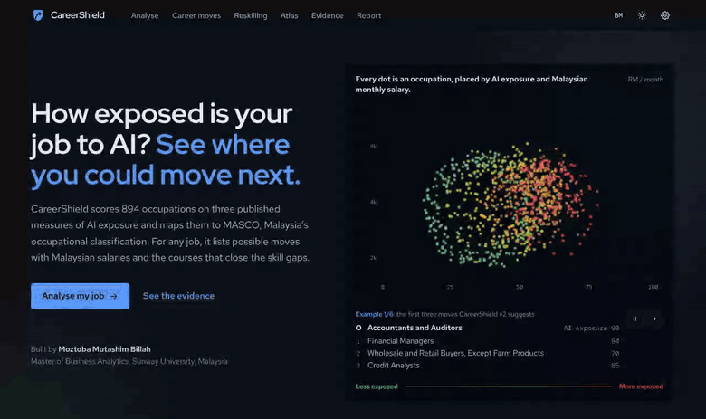
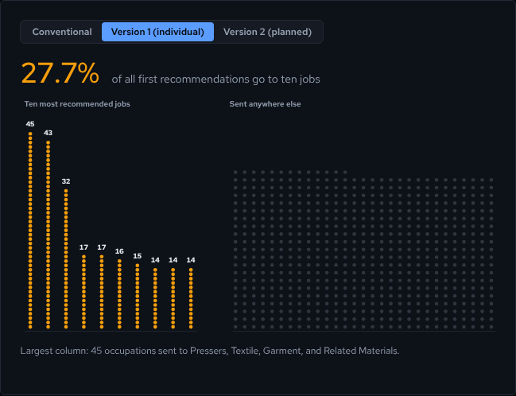
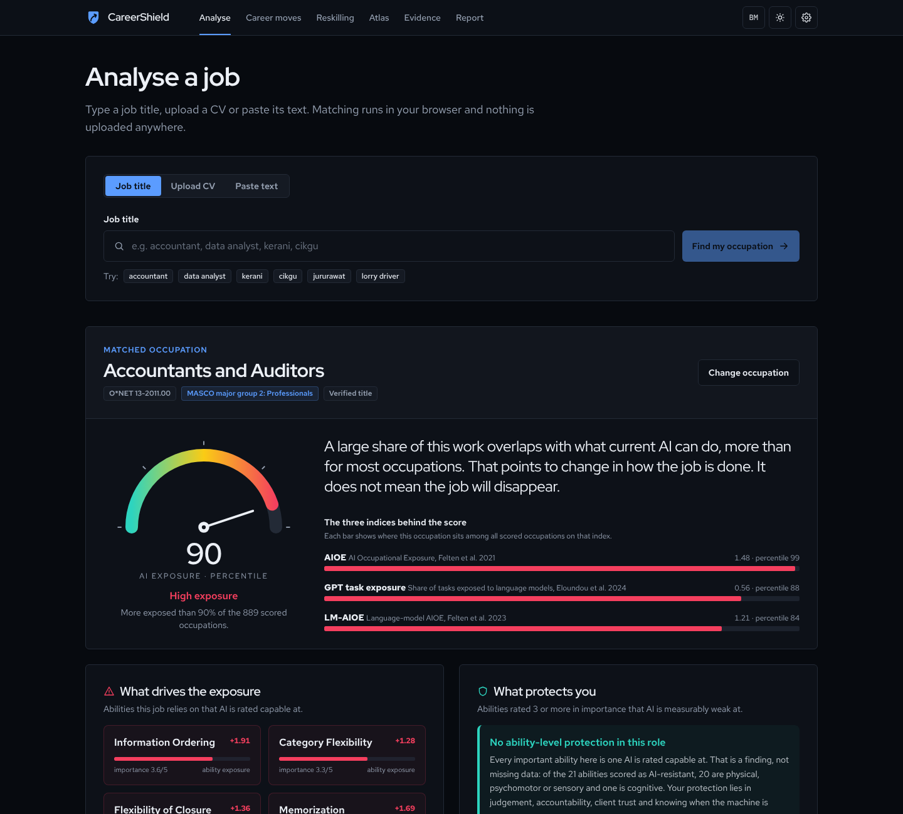
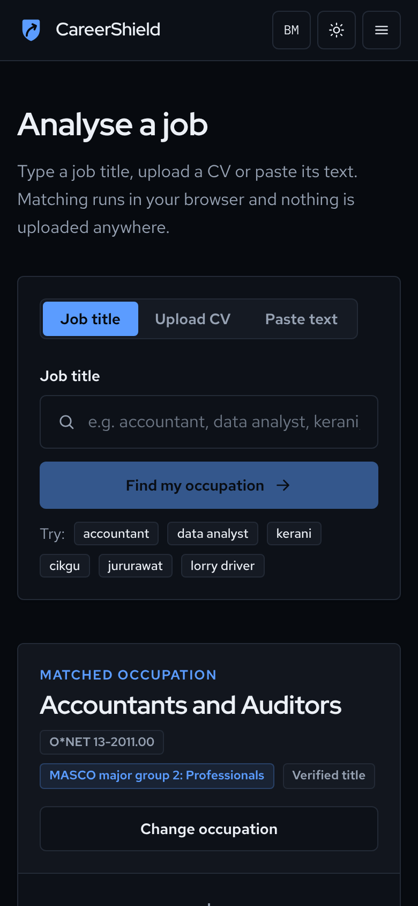

# CareerShield

**See how exposed your work is to AI, and where you could move next.**

CareerShield is a free web app for Malaysian workers. Type a job title in English or Bahasa Malaysia, or
upload a CV, and it shows how much of that occupation's work overlaps with what current AI can do, which
abilities drive the exposure, realistic career moves with Malaysian salaries, and courses that close the
skill gaps. It is the web edition of my Master of Business Analytics research at Sunway University,
and it accompanies a journal paper that is in preparation.

**Live site:** https://moz700.github.io/CareerShield/



## Why it exists

Lists of "AI-safe jobs" rank destinations one worker at a time. In our evaluation of 820 occupations,
that approach (CareerShield v1) lowered observed AI applicability by 21% against conventional advice,
but read as a plan it sent 27.7% of all advice to just ten jobs, and 45 occupations to a single small,
shrinking one. Version 2 adds data guards and caps each destination at 8 origins, computed jointly by
deferred acceptance: the top-10 share falls to 9.8% and 71% of the reduction is kept. The app shows all
three kinds of advice side by side so you can see the difference for your own job.



An exposure score is the overlap between an occupation's tasks and abilities and current AI capability.
It is not a forecast that a job will disappear.

## Features

- **Analyse a job**: title autocomplete (English, Bahasa Malaysia and Malaysian job titles), CV upload
  (PDF, DOCX, TXT) or pasted text, with the five closest occupations to confirm. Files are read in your
  browser and never uploaded.
- **Exposure diagnosis**: animated percentile gauge, the three published indices behind it, a
  plain-language verdict, the abilities that drive exposure and the ones AI is measurably weak at,
  Malaysian salary in RM, hiring demand and a wage-growth outlook.
- **Career moves**: conventional advice, v1 and v2 side by side, with how many evaluated occupations
  receive each destination as their first recommendation, a candidate map and live v1 weight sliders.
- **Reskilling plan**: teachable skill gaps for any destination with matched courses and links.
- **Occupation atlas**: all 894 occupations, searchable and filterable by MASCO major group, as an
  interactive chart or a table, with a detail panel.
- **Evidence**: validation of the measure, the paper's Tables 3 and 4, concentration curves, paired
  differences, the capacity trade-off, method, data sources and licences, and how to cite.
- **Personal report**: print or save as PDF, or download the data as JSON.
- English and Bahasa Malaysia, light and dark themes, keyboard accessible, reduced-motion support.

<p align="center">
  
  
</p>

## Run it locally

You need Node.js 20 or later.

```bash
git clone https://github.com/Moz700/CareerShield.git
cd CareerShield/webapp
npm ci
npm run dev                # http://localhost:5173
```

`npm run build` writes the site to `dist/`. `npm run build:offline` writes a single
`dist-offline/CareerShield.html` that opens from disk without a server.

### Tests

```bash
npx playwright install chromium   # once
npm test                          # unit checks and the end-to-end suite
npm run verify                    # typecheck, build, data checks and tests
```

The end-to-end suite serves the build under a sub-path, the way GitHub Pages does, and walks through
every page and flow. Any console error fails the run. Every number the app shows is checked against the
published evaluation output.

## Rebuild the data

The JSON files in `src/data` are generated from the research code in this repository. To rebuild them:

1. Clone https://github.com/Moz700/CareerShield into `pipeline/inputs/CareerShield` and add the raw
   data as described in its `data/README.md` (O*NET 30.3, BLS OEWS national files, evaluation output).
2. Put `Coursera.csv` in `pipeline/inputs/courses/` and, if you have it, the AIOE data appendix
   (`AIOE_DataAppendix.xlsx`) in `pipeline/inputs/third_party/`.
3. Install the Python requirements and run the public build:

```bash
pip install -r pipeline/requirements.txt
npm run data:public        # python pipeline/build_data.py --public
npm run data:check
```

The build runs the paper's own evaluation code unchanged and stops if any headline number differs from
the published `results.json`. `npm run data:reproduce` repeats the full evaluation with 5,000 bootstrap
replications and compares every value.

`--public` leaves out the HRD Corp e-LATiH course catalogue, which the research team compiled for the
study and does not redistribute. A local build without the flag includes it if
`pipeline/inputs/courses/elatih_courses.csv` is present. Only public builds should be committed.

## Publish

The live site is served by GitHub Pages from the `gh-pages` branch of this repository. To publish a
new version, build it and put the contents of `dist/` on that branch:

```bash
npm run verify             # typecheck, build, data checks and tests
# then copy dist/ to the gh-pages branch and push it
```

The build uses relative paths and hash routes, so it works at `https://<user>.github.io/<repo>/` and at
the root of a custom domain. For a custom domain, build with `SITE_URL` set to the new address, add a
`public/CNAME` file containing the domain, and point the DNS records at GitHub Pages.

## Data and licences

| Source | Used for | Licence |
|---|---|---|
| O*NET 30.3 (National Center for O*NET Development) | occupations, skills, abilities, titles, tasks, related occupations | CC BY 4.0 |
| Felten, Raj and Seamans (2021, 2023); Eloundou et al. (2024) | the three exposure indices; ability-level exposure | published research data, cited |
| U.S. Bureau of Labor Statistics | SOC and ISCO-08 crosswalks, OEWS employment and wages | public domain |
| MASCO 2020 (Ministry of Human Resources Malaysia) | Malaysian occupational groups | official classification, cited |
| JobStreet and LinkedIn postings (Kaggle) | Malaysian demand and salary medians, as aggregated counts only | dataset licences; raw postings not redistributed |
| Tomlinson et al. (2025) AI applicability scores | evaluation only | CC BY 4.0 |
| Coursera public course listing | course matching | links to coursera.org |
| HRD Corp e-LATiH catalogue | course matching in local builds | not redistributed |

The app's code is released under the MIT licence (see `LICENSE`).

## Cite

If you use CareerShield, please cite the paper and the software:

```bibtex
@unpublished{billah2026careershield,
  author = {Billah, Moztoba Mutashim and Paul, Aritra and Al-Obaydee, Mohammed},
  title  = {CareerShield: Measuring occupational exposure to generative artificial intelligence and advising career transitions in the Malaysian labour market},
  year   = {2026},
  note   = {Manuscript in preparation}
}

@software{careershield_2026,
  author  = {Billah, Moztoba Mutashim and Paul, Aritra},
  title   = {CareerShield: AI-exposure-aware career transition advice for Malaysian workers},
  version = {2.2.0},
  year    = {2026},
  url     = {https://github.com/Moz700/CareerShield}
}
```

## User study

The app includes a study mode for a planned evaluation with Malaysian workers: a blinded comparison of
the three kinds of advice for each participant's own occupation, followed by the System Usability Scale.
It is off on the public site and turns on only through a dedicated study link. No data is collected
before ethics approval, and responses never leave the participant's browser until the researcher
exports them.

## Built by

Moztoba Mutashim Billah, Master of Business Analytics, Sunway University.
CareerShield started as a capstone project at Sunway Business School, done with Aritra Paul and
supervised by Dr Mohammed Al-Obaydee.

- GitHub: [github.com/Moz700](https://github.com/Moz700)
- LinkedIn: [linkedin.com/in/moztoba-mutashim-billah](https://www.linkedin.com/in/moztoba-mutashim-billah)
- Email: moztobamutashim@gmail.com

Questions, corrections and collaboration are welcome. Please open an issue on GitHub or email me.

<p align="center">
  <a href="https://moz700.github.io/CareerShield/"></a>
</p>
